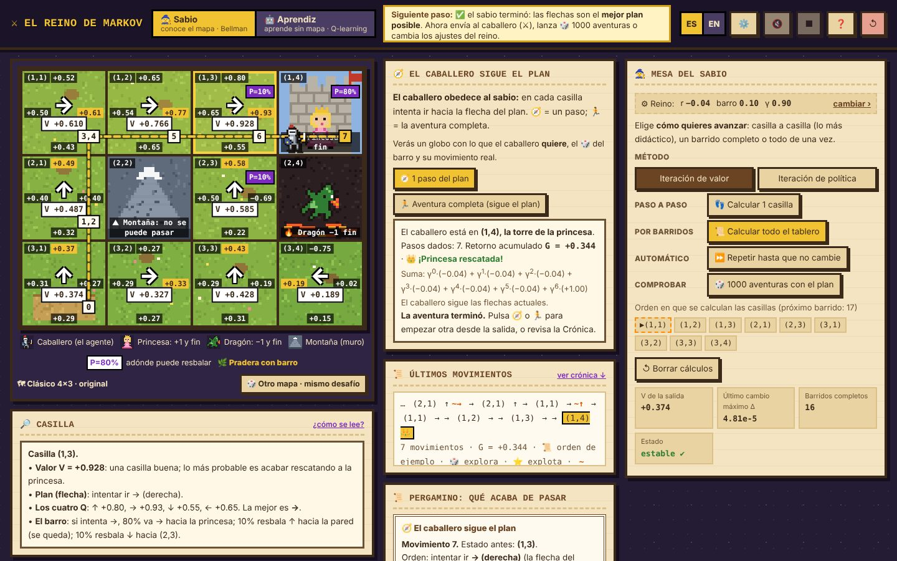
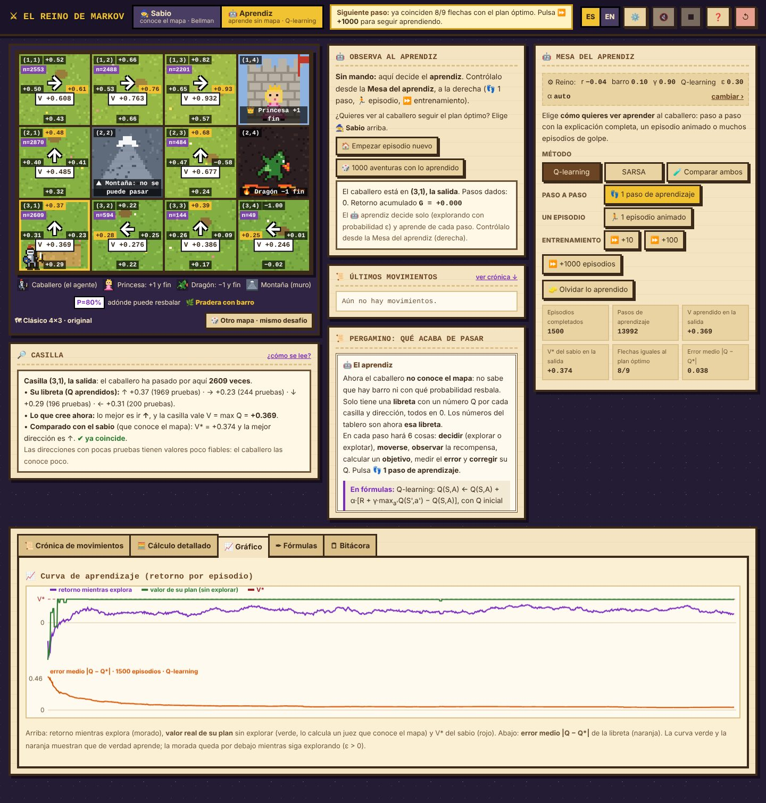

# ⚔ El Reino de Markov

**[🇺🇸 Read in English](README.md)** · **[▶ Probar la demo](https://markov-kingdom.vercel.app)**

Un simulador interactivo, en pixel art medieval, para **entender desde cero los procesos de decisión de Markov (MDP) y el aprendizaje por refuerzo**. Un caballero tiene que rescatar a la princesa sin caer en la guarida del dragón, en un reino lleno de barro donde no siempre llega adonde quiere.

La aplicación muestra **cada cálculo, paso a paso, en palabras y en fórmulas**: la ecuación de Bellman, la iteración de valor, la iteración de política, Q-learning y SARSA. No hace falta saber matemáticas para empezar, y quien ya las sabe puede ver los números exactos.



---

## ¿Qué enseña?

| Concepto                        | Cómo se ve en el reino                                                                                                                                                                               |
| ------------------------------- | ---------------------------------------------------------------------------------------------------------------------------------------------------------------------------------------------------- |
| **Estados y acciones**          | Las casillas del tablero y las cuatro direcciones (↑ → ↓ ←).                                                                                                                                         |
| **Transiciones P**              | El **barro**: el caballero va adonde quiere con probabilidad 1−2p y resbala a cada lado con probabilidad p. El suelo cambia de aspecto según lo resbaladizo: tierra seca, pradera con barro o hielo. |
| **Recompensas R**               | La princesa da **+1**, el dragón **−1** y cada paso cuesta un **cansancio** r (por defecto −0,04). Las montañas no se pueden atravesar.                                                              |
| **Descuento γ y retorno G**     | La **paciencia** del caballero: una recompensa t pasos en el futuro vale γᵗ veces menos.                                                                                                             |
| **Ecuación de Bellman**         | Q(s,a) = Σ P(s′\|s,a)·[R + γ·V(s′)] y V(s) = maxₐ Q(s,a), calculadas casilla a casilla con números reales.                                                                                           |
| **Política**                    | Las flechas del tablero: qué dirección conviene en cada casilla.                                                                                                                                     |
| **Planificar vs. aprender**     | 🧙 El **Sabio** conoce el mapa y calcula; 🤖 el **Aprendiz** no lo conoce y aprende jugando.                                                                                                         |
| **Exploración vs. explotación** | La **curiosidad ε** del aprendiz y su efecto en el retorno.                                                                                                                                          |
| **On-policy vs. off-policy**    | Q-learning frente a SARSA en el acantilado.                                                                                                                                                          |

---

## Los dos personajes

### 🧙 El Sabio: planificación con el modelo

Conoce las probabilidades del barro y las recompensas, y calcula el plan óptimo.

- **Iteración de valor:** prueba las 4 direcciones en cada casilla y se queda con la mejor.
- **Iteración de política:** parte de un plan malo («siempre ↑»), lo evalúa y lo mejora hasta que deja de cambiar.
- **Tres velocidades:** 👣 _una casilla_ (la cuenta completa, fila por fila), 📜 _un barrido_ (todo el tablero una vez; se ve la «onda» de valor que sale de la princesa) y ⏩ _hasta converger_ (hasta que ningún valor cambia más de θ = 0,0001).
- **Comprobación Monte Carlo:** 🎲 _1000 aventuras con el plan_ demuestra que V es el retorno medio real.
- El caballero puede recorrer el plan **paso a paso** (🧭) o la **aventura completa** (🏃). Un globo muestra lo que _quiere_ hacer, el dado del barro y adónde llega de verdad.

### 🤖 El Aprendiz: aprendizaje por refuerzo sin modelo

No conoce el mapa. Solo tiene una **libreta Q**, que empieza en cero, y aprende de la experiencia.

- **Q-learning** (off-policy) y **SARSA** (on-policy), seleccionables.
- **1 paso de aprendizaje** explicado en 6 pasos: decidir (🎲 explorar o ⭐ explotar), moverse, observar la recompensa, calcular el objetivo, medir el error δ y corregir Q.
- **Episodio animado** o **entrenamiento rápido** (+10, +100, +1000 episodios).
- **Curiosidad ε** y **velocidad de aprendizaje α**: automática (1/n^0,7, converge) o fija.
- **Curvas de aprendizaje:**
  - el retorno mientras explora;
  - el **valor real de su plan**, calculado por un «juez» que sí conoce el mapa;
  - el **error medio |Q − Q\*|** frente a los valores exactos del sabio.
- **🧪 Comparar Q-learning y SARSA:** entrena a los dos desde cero y compara caídas, retorno y plan aprendido.



---

## Funcionalidades

- **📖 Ruta guiada de 18 capítulos:** cada capítulo explica una idea, hace una **pregunta de predicción** antes de probarla y tiene un botón **✨ Pruébalo** que la ejecuta en el tablero. Los controles se desbloquean poco a poco. También hay una **ruta libre** con todo a la vista.
- **🗺 Mapas:**
  - **Clásico 4×3**;
  - **Puente del dragón** (camino corto y arriesgado o rodeo seguro, según γ);
  - **Acantilado** (Q-learning vs. SARSA);
  - **Laberinto** (propagación del valor por pasillos).
- **🎲 Otro mapa · mismo desafío:** genera variantes nuevas de cada mapa. Antes de mostrarlas, **resuelve el MDP** y comprueba que la lección sigue en pie (por ejemplo, que con γ = 0,9 el plan arriesga y con γ = 0,99 da el rodeo).
- **✏️ Editor de mapas** de hasta 8×6: montañas, princesas, dragones y salida, con avisos si el mapa no tiene solución.
- **⚙ Ajustes del reino:** cansancio r, barro p y paciencia γ, con atajos («con prisa», «agotado», «le gusta pasear»).
- **📊 Análisis:** crónica de movimientos con repetición animada, cálculo detallado de Bellman, gráfico de convergencia, fórmulas que se iluminan al usarse y bitácora.
- **📤 Exportación** a CSV (trayectoria paso a paso y valores por casilla) y JSON (todo: parámetros, mapa, episodios, curvas y convergencia).
- **💬 Globos de ayuda** en todos los botones, efectos de sonido sintetizados y finales con humor negro (desactivables).
- **🌐 Bilingüe:** español e inglés.

---

## Cómo usarlo

- **En línea:** abre la [demo](https://markov-kingdom.vercel.app).
- **Sin conexión:** descarga `index.html` y ábrelo con doble clic. No necesita internet, ni servidor, ni instalación.

**Recorrido recomendado:** sigue la 📖 Guía (se abre al empezar). Si prefieres explorar por tu cuenta:

1. Pasa el ratón por las casillas y lee el panel 🔎 Casilla.
2. Envía al caballero con 🧭 **antes** de calcular: va a ciegas.
3. Pulsa 👣 _Calcular 1 casilla_ varias veces y lee la cuenta en el pergamino.
4. Pulsa 📜 _Calcular todo el tablero_ y mira cómo se propaga el valor.
5. Pulsa ⏩ hasta converger y comprueba con 🎲 _1000 aventuras_.
6. Cambia el cansancio a −2 y vuelve a calcular: el plan cambia.
7. Pasa al 🤖 Aprendiz, entrena y compara su plan con el del sabio.

---

## Detalles técnicos

- **Un solo archivo HTML** (~340 KB) con HTML, CSS y JavaScript sin librerías ni dependencias externas.
- **Gráficos:** sprites pixel art dibujados en canvas a partir de mapas de caracteres.
- **Sonido:** efectos sintetizados con la Web Audio API, sin archivos de audio.
- **Persistencia:** el idioma, la ruta guiada y los ajustes de sonido se guardan en el `localStorage` del navegador. No se envía ningún dato a ningún servidor.
- Funciona en navegadores modernos de escritorio. En móvil funciona, pero está pensado para pantallas grandes.

### Publicar en Vercel

```bash
npm i -g vercel
vercel --prod
```

O importa este repositorio en vercel.com → _Add New → Project_. No requiere comando de compilación.

---

## Cómo se hizo

Esta aplicación se construyó a lo largo de **muchas iteraciones con [Claude Code](https://claude.com/claude-code), usando el modelo Claude Opus 5.5**. Empezó como un tablero de tres en raya para visualizar la ecuación de Bellman, pasó a un gridworld 4×3 y terminó convirtiéndose en este reino en pixel art. Cada versión se probó, se criticó desde el punto de vista de un estudiante y se mejoró: el modo guiado, el aprendiz con Q-learning y SARSA, el editor de mapas, la exportación de datos y la interfaz bilingüe nacieron de ese ciclo.

---

## Autor

**Romell**: [GitHub](https://github.com/xavendano) · [LinkedIn](https://www.linkedin.com/in/romellavendano/)
