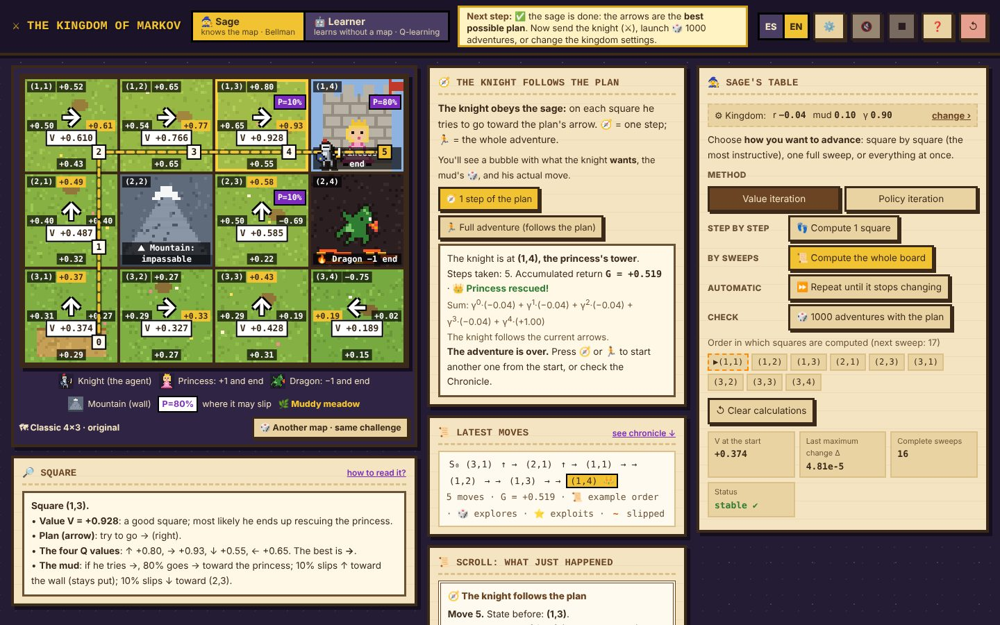
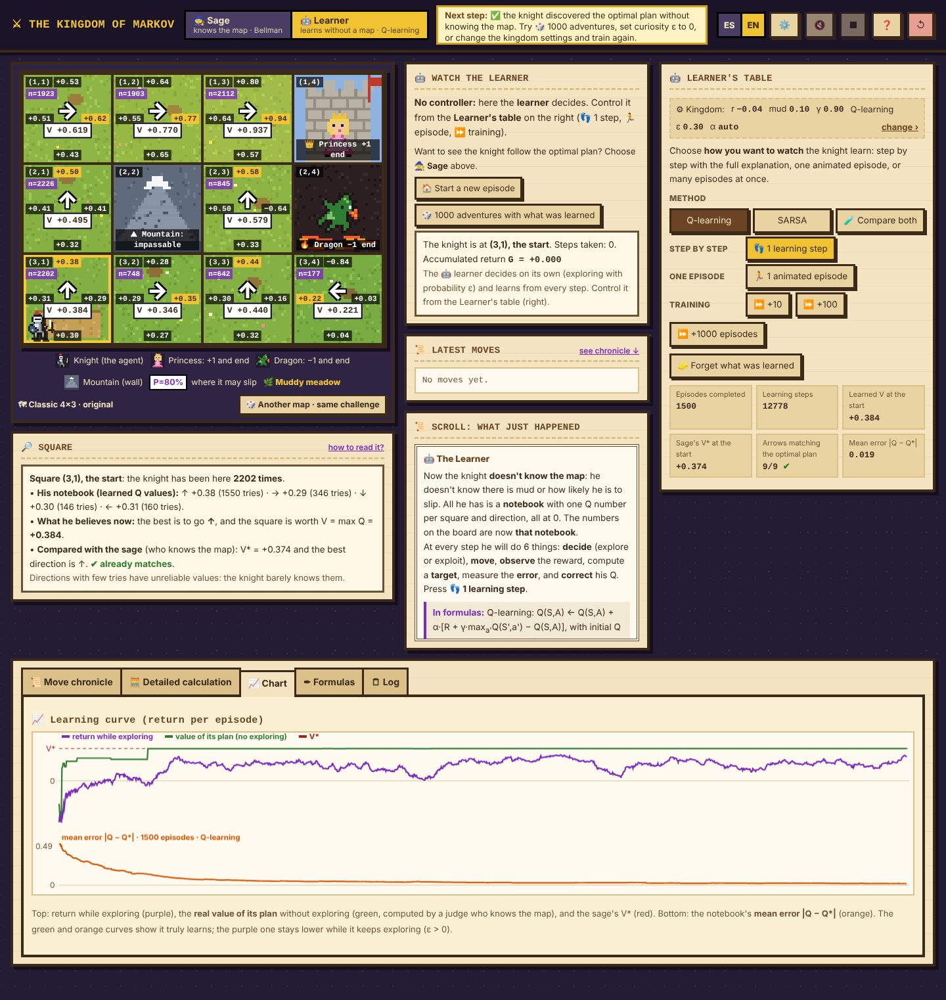

# ⚔ The Kingdom of Markov

**[🇪🇸 Leer en español](README.es.md)** · **[▶ Try the demo](https://markov-kingdom.vercel.app)**

An interactive, medieval pixel-art simulator for **learning Markov decision processes (MDPs) and reinforcement learning from scratch**. A knight must rescue the princess without falling into the dragon's lair, in a muddy kingdom where he doesn't always end up where he intended.

The app shows **every calculation, step by step, in words and in formulas**: the Bellman equation, value iteration, policy iteration, Q-learning, and SARSA. You don't need any math to get started, and those who know it can inspect the exact numbers.



---

## What it teaches

| Concept                          | How it shows up in the kingdom                                                                                                                                                            |
| -------------------------------- | ----------------------------------------------------------------------------------------------------------------------------------------------------------------------------------------- |
| **States and actions**           | The board's squares and the four directions (↑ → ↓ ←).                                                                                                                                    |
| **Transitions P**                | The **mud**: the knight goes where he intends with probability 1−2p and slips to each side with probability p. The ground changes look with slipperiness: dry dirt, muddy meadow, or ice. |
| **Rewards R**                    | The princess gives **+1**, the dragon **−1**, and each step costs **fatigue** r (−0.04 by default). Mountains are impassable.                                                             |
| **Discount γ and return G**      | The knight's **patience**: a reward t steps in the future is worth γᵗ times less.                                                                                                         |
| **Bellman equation**             | Q(s,a) = Σ P(s′\|s,a)·[R + γ·V(s′)] and V(s) = maxₐ Q(s,a), computed square by square with real numbers.                                                                                  |
| **Policy**                       | The arrows on the board: which direction is best on each square.                                                                                                                          |
| **Planning vs. learning**        | 🧙 The **Sage** knows the map and computes; 🤖 the **Learner** doesn't and learns by playing.                                                                                             |
| **Exploration vs. exploitation** | The learner's **curiosity ε** and its effect on the return.                                                                                                                               |
| **On-policy vs. off-policy**     | Q-learning versus SARSA on the cliff.                                                                                                                                                     |

---

## The two characters

### 🧙 The Sage: model-based planning

He knows the mud probabilities and the rewards, and computes the optimal plan.

- **Value iteration:** tries the 4 directions on each square and keeps the best.
- **Policy iteration:** starts from a bad plan («always ↑»), evaluates it, and improves it until it stops changing.
- **Three speeds:** 👣 _one square_ (the full sum, row by row), 📜 _one sweep_ (the whole board once; you can watch the value «wave» spreading out from the princess), and ⏩ _until convergence_ (until no value changes by more than θ = 0.0001).
- **Monte Carlo check:** 🎲 _1000 adventures with the plan_ shows that V is the actual average return.
- The knight can follow the plan **one step at a time** (🧭) or play a **full adventure** (🏃). A bubble shows what he _wants_ to do, the mud die, and where he actually lands.

### 🤖 The Learner: model-free reinforcement learning

He doesn't know the map. He only has a **Q notebook**, starting at zero, and learns from experience.

- **Q-learning** (off-policy) and **SARSA** (on-policy), selectable.
- **One learning step** explained in 6 parts: decide (🎲 explore or ⭐ exploit), move, observe the reward, compute the target, measure the error δ, and correct Q.
- **Animated episode** or **fast training** (+10, +100, +1000 episodes).
- **Curiosity ε** and **learning rate α**: automatic (1/n^0.7, converges) or fixed.
- **Learning curves:**
  - return while exploring;
  - the **true value of its plan**, computed by a «judge» who does know the map;
  - **mean error |Q − Q\*|** against the sage's exact values.
- **🧪 Compare Q-learning and SARSA:** trains both from scratch and compares falls, return, and learned plan.



---

## Features

- **📖 18-chapter guided path:** each chapter explains one idea, asks a **prediction question** before you try it, and has a **✨ Try it** button that runs it on the board. Controls unlock gradually. There is also a **free path** with everything visible.
- **🗺 Maps:**
  - **Classic 4×3**;
  - **Dragon bridge** (short risky path or safe detour, depending on γ);
  - **Cliff** (Q-learning vs. SARSA);
  - **Maze** (value propagating through corridors).
- **🎲 Another map · same challenge:** generates new variants of each map. Before showing one, it **solves the MDP** and checks that the lesson still holds (for example, that with γ = 0.9 the plan takes the risk and with γ = 0.99 it takes the detour).
- **✏️ Map editor** up to 8×6: mountains, princesses, dragons, and the start, with warnings if the map has no solution.
- **⚙ Kingdom settings:** fatigue r, mud p, and patience γ, with presets («in a hurry», «exhausted», «likes to stroll»).
- **📊 Analysis:** move chronicle with animated replay, detailed Bellman calculation, convergence chart, formulas that light up when used, and a log.
- **📤 Export** to CSV (step-by-step trajectory and per-square values) and JSON (everything: parameters, map, episodes, curves, and convergence).
- **💬 Tooltips** on every button, synthesized sound effects, and darkly humorous endings (all can be turned off).
- **🌐 Bilingual:** Spanish and English.

---

## How to use it

- **Online:** open the [demo](https://markov-kingdom.vercel.app).
- **Offline:** download `index.html` and double-click it. No internet, server, or installation needed.

**Recommended path:** follow the 📖 Guide (it opens when you start). If you'd rather explore on your own:

1. Hover over the squares and read the 🔎 Square panel.
2. Send the knight with 🧭 **before** computing anything: he's walking blind.
3. Press 👣 _Compute 1 square_ a few times and read the calculation in the scroll.
4. Press 📜 _Compute the whole board_ and watch the value spread.
5. Press ⏩ until convergence and check it with 🎲 _1000 adventures_.
6. Set fatigue to −2 and compute again: the plan changes.
7. Switch to the 🤖 Learner, train it, and compare its plan with the sage's.

---

## Technical details

- **A single HTML file** (~340 KB) with HTML, CSS, and JavaScript, no libraries or external dependencies.
- **Graphics:** pixel-art sprites drawn on canvas from character maps.
- **Sound:** effects synthesized with the Web Audio API, no audio files.
- **Persistence:** language, guided path, and sound settings are stored in the browser's `localStorage`. No data is sent to any server.
- Works in modern desktop browsers. It runs on mobile, but it's designed for larger screens.

### Deploy to Vercel

```bash
npm i -g vercel
vercel --prod
```

Or import this repository at vercel.com → _Add New → Project_. No build command required.

---

## How it was built

This app was built over **many iterations with [Claude Code](https://claude.com/claude-code), using the Claude Opus 5.5 model**. It started as a tic-tac-toe board to visualize the Bellman equation, moved on to a 4×3 gridworld, and grew into this pixel-art kingdom. Each version was tested, critiqued from a learner's point of view, and improved: the guided path, the Q-learning and SARSA learner, the map editor, data export, and the bilingual interface all came out of that loop.

---

## Author

**Romell**: [GitHub](https://github.com/xavendano) · [LinkedIn](https://www.linkedin.com/in/romellavendano/)
